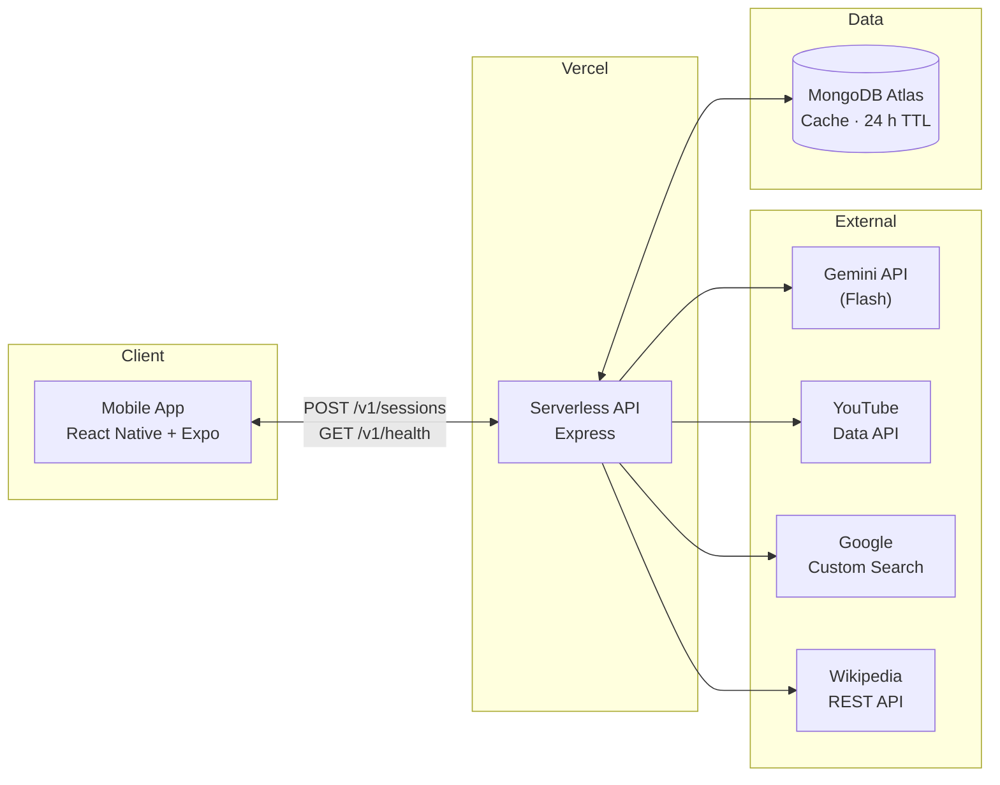
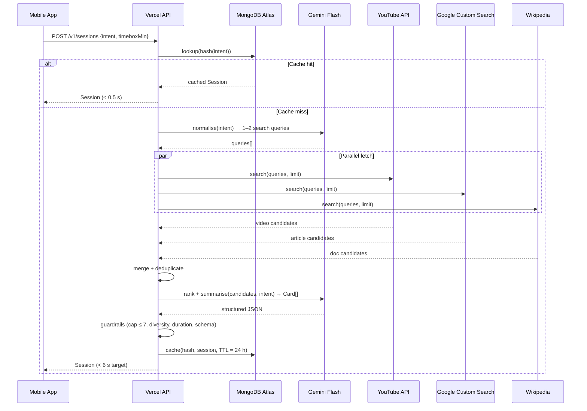
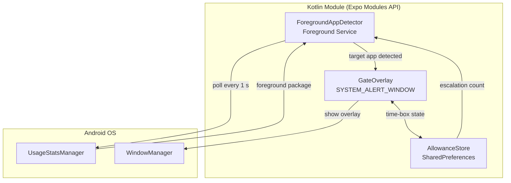

# PLAN.md — Skip the Scroll

> Architecture, repo layout, pipeline, risks, and open questions.
> Approved scope: **English only**, polished. Multilingual is a later milestone.

---

## 1. Architecture Overview



| Layer | Responsibility | Runs on |
|-------|---------------|---------|
| **Mobile app** | UI, navigation, on-device storage (intents, stats, saved cards, session log). All user data stays local. | User's phone (Android dev build) |
| **API** | Stateless content pipeline. Takes an intent, orchestrates providers + LLM, returns a `Session`. Holds no user state. | Vercel serverless (free tier) |
| **Cache** | Query-level cache keyed by normalised query hash. 24 h TTL via MongoDB TTL index. Not tied to any user/device. | MongoDB Atlas (free tier, 512 MB) |
| **External APIs** | Gemini (normalise + rank + summarise), YouTube Data API (videos), Google Custom Search (articles), Wikipedia REST API (definitions). | Google Cloud / Wikimedia |

---

## 2. Repo Layout

```
Bot/                                ← project root
├── SPEC.md
├── PLAN.md
├── DECISIONS.md
├── .env.example
├── .gitignore
├── package.json                    ← pnpm workspace root
├── pnpm-workspace.yaml
│
├── apps/
│   ├── mobile/                     ← Expo + React Native (TypeScript)
│   │   ├── app/                    ← Expo Router file-based routing
│   │   │   ├── _layout.tsx         ← root layout
│   │   │   ├── index.tsx           ← Intent screen
│   │   │   ├── deck/[id].tsx       ← Deck (horizontal pager)
│   │   │   ├── end/[id].tsx        ← End screen
│   │   │   ├── library.tsx         ← saved cards (M4)
│   │   │   ├── insights.tsx        ← stats dashboard (M4)
│   │   │   └── settings.tsx        ← target apps, pause, etc. (M3+)
│   │   ├── components/             ← Card, Counter, ChipGroup, EndActions…
│   │   ├── hooks/                  ← useSession, useDeck, useLocalLog…
│   │   ├── store/                  ← AsyncStorage / MMKV helpers
│   │   ├── fixtures/               ← M1 JSON test sessions
│   │   ├── constants/              ← colours, caps, durations
│   │   ├── __tests__/
│   │   ├── app.json
│   │   ├── tsconfig.json
│   │   └── package.json
│   │
│   └── api/                        ← Vercel serverless backend
│       ├── api/
│       │   └── index.ts            ← Express app entry (single function)
│       ├── src/
│       │   ├── app.ts              ← Express app (routes, middleware)
│       │   ├── server.ts           ← local dev: app.listen(3000)
│       │   ├── routes/
│       │   │   ├── sessions.ts     ← POST /v1/sessions
│       │   │   └── health.ts       ← GET /v1/health
│       │   ├── providers/
│       │   │   ├── provider.ts     ← Provider interface
│       │   │   ├── youtube.ts
│       │   │   ├── google-search.ts
│       │   │   └── wikipedia.ts
│       │   ├── llm/
│       │   │   ├── client.ts       ← LLMClient interface
│       │   │   ├── gemini.ts       ← Gemini Flash implementation
│       │   │   └── prompts/        ← versioned .txt prompt files
│       │   ├── cache/
│       │   │   └── mongo.ts        ← connect, get, set, TTL index
│       │   ├── pipeline.ts         ← orchestration: normalise → fetch → rank → guard
│       │   └── guardrails.ts       ← card cap, diversity, duration fit
│       ├── __tests__/
│       ├── vercel.json
│       ├── tsconfig.json
│       └── package.json
│
└── packages/
    └── shared/                     ← shared TypeScript types
        ├── src/
        │   └── types.ts            ← Card, Session, Provider, etc.
        ├── tsconfig.json
        └── package.json
```

---

## 3. Content Pipeline (Pull)



### Guardrails (plain code, not in the LLM)

| Rule | Detail |
|------|--------|
| Card cap | Default 7, hard max 10. Never pad; if < 3 candidates, return fewer and say so. |
| Diversity | At least 1 non-video card when article/doc candidates exist. |
| Duration fit | Total estimated minutes ≤ user's time-box. Drop longest cards first. |
| No junk | Filter sub-60 s clips (unless mode = Watch), clickbait heuristic (title length, caps ratio). |
| Schema validation | LLM output validated against `Card` schema; malformed cards dropped, not patched. |

### Fallback chain

| Failure | Behaviour |
|---------|-----------|
| Gemini down | Use raw intent as search query; skip LLM ranking; sort by provider relevance score. Label results as "unranked." |
| YouTube quota exhausted | Articles + Wikipedia only. Show a small notice: "Video results unavailable right now." |
| Google Custom Search down | YouTube + Wikipedia only. |
| Wikipedia down | YouTube + articles only. |
| All providers down | Error screen with retry button. |
| < 3 good candidates | Show what exists. End screen says "We found fewer results than usual." |

---

## 4. Gate Architecture (M3 · Android)



**Permissions required (in onboarding order):**

1. **Usage Access** — "We check which app just opened so we can show the gate. We never read what's inside other apps."
2. **Display over other apps** — "We show a full-screen pause before the app opens."
3. **Battery optimisation exemption** (recommended) — "Some phones stop background apps aggressively. This keeps the gate working."

**Escalation logic:** If the same target app is opened > 1× within a rolling 60-minute window, pause length increases: 5 → 10 → 15 s (capped). Resets after 60 min of no opens.

---

## 5. Milestone Breakdown

### M0 — Plan ✅

- [x] PLAN.md (this document)
- [x] DECISIONS.md (initial decisions)
- **Output:** approved plan, resolved questions, no feature code.

---

### M1 — Deck with fixtures

> Goal: a fully navigable offline app. Intent → Deck → End. Nothing scrolls infinitely.

| # | Task | Test |
|---|------|------|
| 1 | Scaffold Expo project (dev build, Expo Router, TypeScript) | App boots |
| 2 | `packages/shared` with `Card` and `Session` types | Types compile |
| 3 | Intent screen: text input, mode chips (Learn · Fix · Watch · Read), time-box chips (5 / 10 / 20 min), recent intents (AsyncStorage) | Input → chips → submit works |
| 4 | Deck screen: `react-native-pager-view`, card component, counter ("3 of 7") | Swipe left/right; counter updates; stops at last card |
| 5 | End screen: "Did you get what you needed?" + Done / Refine / Save | Done → Intent; Refine → Intent (clear); Save → logs card |
| 6 | Fixture data: 3 realistic sessions, 5–7 cards each | Loaded correctly |
| 7 | Navigation wiring: Intent → fixture lookup → Deck → End → Intent | Full loop works |
| 8 | Local session log (AsyncStorage): intent, timestamp, outcome | Log persists across restarts |
| 9 | Unit tests: card cap ≤ 10, end screen after last card, counter accuracy, no infinite-scroll paths | `pnpm test` passes |

**Accept when:** works fully offline · no screen can scroll infinitely · card cap enforced · counter accurate · end screen appears after last card · unit tests pass.

---

### M2 — Real content

> Goal: a live query returns a good deck from real sources.

| # | Task | Test |
|---|------|------|
| 1 | Vercel project: Express entry point, `vercel.json`, env vars | `GET /v1/health` returns 200 |
| 2 | MongoDB Atlas: connection helper with warm-instance caching, TTL index | Cache set/get works in test |
| 3 | Provider interface + YouTube, Google Custom Search, Wikipedia implementations | Each provider returns candidates for a known query |
| 4 | `LLMClient` interface + Gemini Flash implementation | Structured JSON output parses correctly |
| 5 | Prompt files: `normalise.txt`, `rank-summarise.txt` under `src/llm/prompts/` | Versioned, committed |
| 6 | Pipeline: normalise → parallel fetch → merge → rank → guardrails → cache → respond | End-to-end for a test query |
| 7 | Quota monitor: log YouTube + Custom Search calls, warn at 80% | Logged in console / Vercel logs |
| 8 | Connect mobile to API: replace fixture lookup with `POST /v1/sessions` | Real cards appear in deck |
| 9 | Loading skeleton, error screen, offline fallback ("you're offline") on every screen | Each state reachable |
| 10 | Tests: provider fallbacks, LLM JSON validation, quota guard, card cap | `pnpm test` passes |

**Accept when:** real query → 3–7 valid cards in < 6 s (cache miss), < 0.5 s (hit) · a failure in any single provider degrades gracefully · quota guard logs usage · tests pass.

---

### M3 — Android gate

> Goal: opening a target app triggers the gate on a Samsung phone.

| # | Task | Test |
|---|------|------|
| 1 | Kotlin module scaffold via Expo Modules API | Module loads in dev build |
| 2 | `ForegroundAppDetector`: foreground service + UsageStatsManager polling | Detects Instagram/YouTube foreground |
| 3 | `GateOverlay`: full-screen overlay, 5 s breathing pause, three options | Overlay appears; options navigate correctly |
| 4 | `AllowanceStore`: time-box countdown, escalation (5→10→15 s) | Timer counts down; escalation triggers on repeated opens |
| 5 | Settings UI: target app picker, pause length slider (3–15 s), allowance | Settings persist across restarts |
| 6 | Permission onboarding: step-by-step, plain language, "Why am I seeing this?" link | All permissions grantable from onboarding |
| 7 | Battery exemption onboarding for Samsung | Service survives 30 min background on Samsung |
| 8 | Deep link: `skipthescroll://intent?from=<app>` | Gate → "Look something up" → Intent screen with source |
| 9 | Reboot survival: service restarts on BOOT_COMPLETED | Gate works after reboot |
| 10 | Battery impact measurement | Measured, noted in DECISIONS.md |

**Accept when:** gate appears within ~1 s on Samsung · all three options work · "continue anyway" needs an extra tap · survives reboot · permission onboarding in plain language · battery impact measured.

---

### M4 — Library and insights

> Goal: saved cards and a weekly stats dashboard.

| # | Task | Test |
|---|------|------|
| 1 | Save action: from deck card and end screen → local storage | Card appears in library |
| 2 | Library screen: cards grouped by intent, tap to open | Renders saved cards; link opens |
| 3 | Insights screen: sessions started/finished, done rate, gate shown/redirected/continued, estimated minutes saved (labelled "estimate") | Numbers match manual test |
| 4 | Weekly view toggle | Shows last-7-day data |
| 5 | Local stats export (JSON file) | Exportable, valid JSON |

**Accept when:** saved cards persist · insights are accurate for 7-day window · stats exportable as JSON.

**Status:** ✅ Implemented in the app. 7-day and 30-day views are available, saved cards persist locally, and dogfood statistics export through the native share sheet.

---

## 6. Risks & Mitigations

| # | Risk | Impact | Likelihood (MVP) | Mitigation |
|---|------|--------|-------------------|------------|
| R1 | YouTube API quota: ~100 searches/day | No video cards after quota | Low (10 users, cached) | 24 h cache; article-only fallback; quota logging; batch `videos.list` calls |
| R2 | Google Custom Search: 100 queries/day free | No article cards after quota | Low (same) | Shared cache; YouTube + Wikipedia fallback |
| R3 | Vercel free-tier 10 s function timeout | 504 on slow pipeline | Medium | Gemini Flash (fast); parallel fetches; 3 s per-provider timeout; degrade to fewer sources |
| R4 | Vercel cold starts (~1–3 s) | First request feels slow | Medium | Vercel cron job pings `/v1/health` every 5 min; minimal `node_modules` |
| R5 | Samsung killing foreground service | Gate stops working | High | Battery exemption onboarding; `BOOT_COMPLETED` receiver; test on real device |
| R6 | Play Store policy for overlay + usage stats | Can't publish | N/A for MVP | Sideload / EAS internal build; revisit policy before public release |
| R7 | Gemini API quota / outage | Pipeline fails | Low | `LLMClient` interface swappable; fallback to unranked results |
| R8 | MongoDB Atlas free-tier 512 MB limit | Cache full | Low (24 h TTL) | TTL auto-expires; monitor size |
| R9 | `react-native-pager-view` bugs | Swipe issues | Low | Well-maintained library; fallback to `FlatList` with `pagingEnabled` |

---

## 7. Environment Variables

```env
# .env.example
GEMINI_API_KEY=
YOUTUBE_API_KEY=
GOOGLE_CSE_ID=                # Custom Search Engine ID
GOOGLE_CSE_API_KEY=            # can be same as YOUTUBE_API_KEY if same GCP project
MONGODB_URI=                   # mongodb+srv://...
NODE_ENV=development
```

---

## 8. Open Questions (non-blocking)

These can be resolved during M1/M2. None block the plan.

1. **Local storage engine** — AsyncStorage is fine for MVP. MMKV is faster but adds a native dependency. Decision deferred to M1; either works.
2. **Expo SDK version** — Use the latest stable SDK at scaffold time. Pin it in `app.json`.
3. **Testing framework** — Jest (Expo default) for unit tests. React Native Testing Library for component tests. Confirm the team is comfortable.
4. **Card thumbnail** — YouTube provides thumbnails. For articles, we can use the page's Open Graph image or omit. Decide in M2.
5. **Vercel project region** — Default to `iad1` (US East) unless latency from Pakistan is a problem; then `sin1` (Singapore). Measure in M2.

---

## 9. What's explicitly out of scope

Per SPEC.md §11 and §5 ("Later"): accounts, social features, any feed, ads, recommendations beyond the query, scraping, iOS gate, browser extension, monetisation, multilingual (deferred).

---

*End of plan. Ready for M1 on your "go."*
